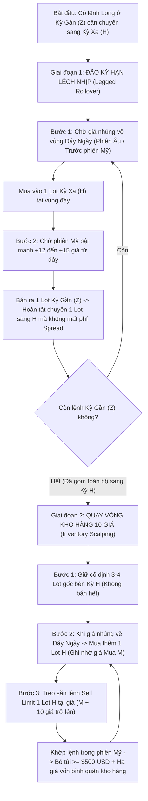

# CẨM NANG CHIẾN THUẬT: ĐẢO KỲ HẠN LỆCH NHỊP & QUAY VÒNG KHO HÀNG MÙA VỤ (10 GIÁ)
**Hệ Thống Giao Dịch Thực Chiến Nông Sản CBOT (Lúa Mì & Ngô)**  
*Tác giả ý tưởng gốc: Anh Thắng — Hệ thống hóa & Mô hình hóa Toán học: Antigravity*

---

> [!IMPORTANT]
> **Triết lý cốt lõi của phương pháp:**
> Trong giao dịch hàng hóa theo mùa vụ (Seasonal Trading) ở vùng đáy năm, sai lầm lớn nhất của nhà đầu tư truyền thống là **"Mua gom một cục rồi ngồi im gồng lỗ chờ sóng lớn"** hoặc **"Bán hết cùng lúc dẫn đến mất hàng khi vào sóng"**.
> 
> Phương pháp này giải quyết triệt để bài toán đó bằng nguyên tắc: **Tách biệt hoàn toàn "Sổ cái kế toán của sàn" và "Giá Mua/Bán của lệnh gần nhất"**. Chúng ta giữ một lượng Lot nền tảng ở kỳ hạn xa, và liên tục lấy **giá mua vào gần nhất ở đáy ngày** làm mốc tham chiếu — **chỉ cần giá bật lên $\ge 10$ giá là bán ra đúng 1 Lot đó**.

---

## PHẦN 1: BẢN CHẤT TOÁN HỌC — TẠI SAO "3 LỆNH ĐẦU BÁO LỖ, TỪ LỆNH THỨ 4 BÁO LÃI RÒNG"?

Trên phần mềm CQG (và mọi sàn phái sinh Mỹ), hệ thống kế toán bắt buộc áp dụng quy tắc **FIFO (First-In, First-Out — Lệnh nào Mua trước sẽ bị Đóng trước)**. 
Trong khi đó, tư duy thực chiến của chúng ta là **LIFO (Last-In, First-Out — Tính hiệu quả trên đúng lệnh Mua gần nhất và lệnh Bán gần nhất)**.

### Bảng Mô Phỏng Thực Tế Quá Trình "Rửa Giá Vốn" & Thu Hồi Vốn

Giả sử danh mục ban đầu đang có **3 Lots** bị kẹt ở giá cao:
* **Lot 1 (`ZWZ26`):** Giá mua `621.0`
* **Lot 2 (`ZWZ26`):** Giá mua `607.0`
* **Lot 3 (`ZWH27`):** Giá mua `635.0`
*(Độ lệch giá Spread giữa kỳ Z và kỳ H là **12.0 giá**).*

Khi thị trường rơi về vùng đáy năm (`ZWZ26 = 586.0` | `ZWH27 = 598.0`), nhưng trong ngày luôn có nhịp bật `12 – 15 giá` vào đầu phiên Mỹ, chúng ta thực thi **4 vòng quay liên tiếp**:

| Vòng quay | Hành động Mua (Tại đáy ngày) | Hành động Bán (Khi bật $\ge 10-14$ giá) | Lợi nhuận Thực Tế của Vòng Quay (Đút túi) | Sổ cái CQG khớp đóng vào Lot nào? (Theo FIFO) | Báo cáo Lãi/Lỗ trên Sổ cái CQG | Kho hàng còn lại sau vòng quay |
| :--- | :--- | :--- | :---: | :--- | :---: | :--- |
| **Vòng 1** *(Chuyển Lot Z thứ 1 sang H)* | **Mua 1 Lot H** tại **`598.0`** *(khi Z ở 586)* | **Bán 1 Lot Z** tại **`600.0`** *(khi Z bật +14 giá)* | **+14.0 giá trên Z** *(Đổi sang H lãi ngược +2.0 giá so với Spread 12)* | Đóng vào **Lot 1 Z (`621.0`)** | Báo lỗ sổ sách: `-21.0 giá` *(600 - 621)* | • 1 Lot Z (`607.0`) • 1 Lot H (`635.0`) • **1 Lot H (`598.0`)** |
| **Vòng 2** *(Chuyển Lot Z thứ 2 sang H)* | **Mua 1 Lot H** tại **`597.0`** *(khi Z ở 585)* | **Bán 1 Lot Z** tại **`599.0`** *(khi Z bật +14 giá)* | **+14.0 giá trên Z** *(Đổi sang H lãi ngược +2.0 giá so với Spread 12)* | Đóng vào **Lot 2 Z (`607.0`)** | Báo lỗ sổ sách: `-8.0 giá` *(599 - 607)* | • 1 Lot H (`635.0`) • **1 Lot H (`598.0`)** • **1 Lot H (`597.0`)** *(Đã sạch bóng kỳ Z!)* |
| **Vòng 3** *(Quay vòng 10 giá trên H)* | **Mua 1 Lot H** tại **`596.0`** | **Bán 1 Lot H** tại **`607.0`** *(Bật +11 giá)* | **+11.0 giá** **(+$550 USD)** | Đóng vào **Lot 3 H cũ nhất (`635.0`)** | Báo lỗ sổ sách: `-28.0 giá` *(607 - 635)* | • **1 Lot H (`598.0`)** • **1 Lot H (`597.0`)** • **1 Lot H (`596.0`)** *(Giá TB còn **597.0**!)* |
| **Vòng 4 trở đi** *(Thu hoạch lãi ròng)* | **Mua 1 Lot H** tại **`596.0`** | **Bán 1 Lot H** tại **`606.0`** *(Bật +10 giá)* | **+10.0 giá** **(+$500 USD)** | Đóng vào **Lot H (`598.0`)** | **NỔ LÃI RÒNG:** **`+8.0 giá`** *(606 - 598)* | • **1 Lot H (`597.0`)** • **1 Lot H (`596.0`)** • **1 Lot H (`596.0`)** |

> [!TIP]
> **Kết luận từ Bảng Toán Học trên:**
> 1. Chỉ sau **3 vòng quay đầu tiên**, toàn bộ các lệnh giá cao (`621`, `607`, `635`) đã bị xóa sạch khỏi tài khoản.
> 2. Danh mục 3 Lot giữ lại trong tài khoản đã được **"thay máu" hoàn toàn về vùng giá đáy `596.0 – 597.0`** mà không tốn 1 xu phí Contango nào.
> 3. **Từ vòng thứ 4 trở đi**, mỗi nhịp mua đáy bán bật 10 giá vừa mang lại **+$500 USD tiền mặt**, vừa báo **Xanh (Lãi ròng)** trực tiếp trên bảng sao kê CQG!

---

## PHẦN 2: QUY TRÌNH CHI TIẾT 2 KỸ THUẬT TÁC CHIẾN

### Kỹ thuật 1: Đảo Kỳ Hạn Lệch Nhịp (Legged Rollover)
* **Mục đích:** Giải thoát các lệnh ở kỳ hạn sắp đáo hạn (FND) sang kỳ hạn xa hơn mà **không bị mất 12–15 giá phí chênh lệch kỳ hạn (Contango)**.
* **Cơ sở thị trường:** Trong giai đoạn Rollover (từ ngày 5 đến ngày 20 của tháng trước FND), phe Short bắt buộc phải mua lại một phần vị thế ở kỳ gần trước khi đè giá tiếp, tạo ra các nhịp bật cố định **13 – 20 giá** vào đầu phiên Mỹ.
* **Quy tắc thực thi:**
  1. Tuyệt đối không bán Z và mua H cùng một lúc khi giá đang lơ lửng.
  2. Khi giá bị đè về đáy trong phiên chiều/tối (trước 21:30 VN) $\rightarrow$ **MUA trước 1 Lot kỳ H**.
  3. Khi mở cửa phiên Mỹ (21:30 – 23:00 VN), giá bật lên từ đáy **13 – 15 giá** $\rightarrow$ **BÁN trả lại 1 Lot kỳ Z**.

### Kỹ thuật 2: Quay Vòng Kho Hàng Mùa Vụ 10 Giá (Seasonal Inventory Scalping)
* **Mục đích:** Áp dụng lâu dài quanh năm khi đánh theo mùa vụ ở vùng giá thấp. Vừa giữ được kho hàng lớn ở đáy đón sóng trung hạn, vừa lấy tiền mặt hàng ngày từ các nhịp co giật ngắn hạn.
* **Quy tắc thực thi ("Chỉ quan tâm giá Mua/Bán gần nhất"):**
  1. Sau khi đã gom toàn bộ vị thế sang kỳ hạn xa (ví dụ `ZWH27` hoặc `ZWK27`), quên đi mức "giá bình quân" hiển thị trên màn hình.
  2. Mỗi khi giá giảm về vùng đáy ngày $\rightarrow$ **Mua vào 1 Lot** (Gọi giá vừa mua là $P_{\text{mua}}$).
  3. Lập tức đặt lệnh chờ **Bán ra đúng 1 Lot** tại mức giá:
     $$P_{\text{bán}} \ge P_{\text{mua}} + 10\text{ giá}$$
  4. **Nguyên tắc bất di bất dịch:** Mua thêm 1 Lot thì chỉ bán ra 1 Lot. Tổng số Lot gốc (3–4 Lots) luôn nằm yên trong tài khoản để nếu ngày mai thị trường nổ sóng tăng 40–50 giá, chúng ta ăn trọn con sóng lớn trên toàn bộ kho hàng gốc!

---

## PHẦN 3: KHUNG GIỜ VÀNG & TÍN HIỆU NẾN TRONG NGÀY (CHART M15)

Để tỷ lệ khớp lệnh đạt hiệu suất cao nhất, việc canh thời điểm trong ngày theo giờ Việt Nam (Mùa Đông Mỹ) là yếu tố then chốt:

| Pha giao dịch trong ngày | Khung giờ (Giờ VN) | Đặc điểm hành vi giá CBOT | Hành động của chúng ta |
| :--- | :---: | :--- | :--- |
| **Pha 1: Đè giá quét đáy** *(Phiên Âu & Trước nghỉ chuyển phiên)* | **15:00 – 17:30** và **19:30 – 20:45** | Thanh khoản mỏng, phe Short thường đạp thủng đáy cũ 3–5 giá để quét Stop-loss (như nhịp đè về 585.0). | **Canh MUA vào 1 Lot kỳ H** khi thấy nến M15 bắt đầu chững lại / rút chân kèm Volume cao. |
| **Pha 2: Nghỉ giữa phiên** | **20:45 – 21:30** | Sàn tạm nghỉ 45 phút trước khi mở cửa sàn chính Chicago. | Chuẩn bị sẵn kịch bản và tính toán mức giá **+10 đến +14 giá** để treo lệnh Bán. |
| **Pha 3: Bùng nổ đầu phiên Mỹ** *(US Pit Open)* | **21:30 – 23:00** *(4–6 cây nến M15 đầu tiên)* | Dòng tiền tổ chức ồ ạt đổ vào thực hiện lệnh Roll và Short-covering, thường kéo giá bật mạnh **12 – 15 giá** trong vòng 1 tiếng. | **Treo sẵn lệnh SELL LIMIT 1 Lot** (cách giá mua đáy $\ge 10-14$ giá) để khớp chốt lời ngay trên đỉnh cây nến bật. |
| **Pha 4: Giằng co cuối phiên Mỹ** | **23:30 – 02:20 sáng** | Sau khi mua đủ lượng hàng cần Roll trong ngày, phe Short thường thả cho giá trôi ngược về vùng thấp để đóng cửa. | **Không mua đuổi, không giao dịch.** Đã chốt xong vòng quay trong ngày, nghỉ ngơi chờ vòng quay ngày hôm sau. |

---

## PHẦN 4: KỊCH BẢN XỬ LÝ KHI GIÁ TRƯỢT SÂU HƠN DỰ KIẾN (585 $\rightarrow$ 570 $\rightarrow$ 560)

Trong trường hợp xấu nhất (ví dụ tin đàm phán địa chính trị hoặc báo cáo WASDE ép giá thủng mốc `585` về `570` hoặc `560`), với sức chịu đựng của tài khoản lên tới **9 – 10 Lots**, chúng ta xử lý theo **Chiến thuật Phân Tầng Bắt Đáy & Xả Ngược Từng Bậc**:

### 1. Quy trình Nâng Bậc Vị Thế theo Bước Giá (10 – 15 Giá/Lot)
Giả sử tại vùng `585` (quy chiếu theo kỳ Z), tài khoản đang nắm **4 Lots bên kỳ H**:
* **Bậc 1 — Khi giá trượt về `570` (giảm thêm 15 giá):** Mua thêm **1 Lot kỳ H** $\rightarrow$ Tổng vị thế nâng lên **5 Lots**.
* **Bậc 2 — Khi giá trượt về `560` (giảm thêm 10 giá):** Mua thêm **1 Lot kỳ H** $\rightarrow$ Tổng vị thế nâng lên **6 Lots**.
*(Lúc này vẫn còn dư địa an toàn 3–4 Lots so với trần sức mua 9–10 Lots của tài khoản).*

### 2. Quy trình Giải Ngân Ngược Khi Giá Bật Lại (Xả Từng Lot 10 – 15 Giá)
Khi giá chạm vùng kiệt sức (`560 – 570`) và bắt đầu nảy lên hoặc đảo chiều:
* **Lệnh mua ở `560`:** Khi giá bật lên **`570 – 575`** (+10 đến +15 giá) $\rightarrow$ **Bán giải ngân 1 Lot** (Hạ về 5 Lots).
* **Lệnh mua ở `570`:** Khi giá tiếp tục hồi lên **`580 – 585`** (+10 đến +15 giá) $\rightarrow$ **Bán giải ngân 1 Lot** (Hạ về 4 Lots gốc).
* **Kết quả:** Càng nhúng sâu ở vùng đáy năm, các Lot mua thêm ở `570` và `560` càng trở thành "đòn bẩy thu hồi vốn" cực nhanh khi thị trường bật lại, đồng thời kéo giá bình quân trên sổ cái CQG xuống mức thấp kỷ lục.

---

## PHẦN 5: LƯU Ý CỐT TỬ — KHI NÀO ÁP DỤNG & KHI NÀO BẮT BUỘC NGƯNG?

> [!CAUTION]
> **ĐIỀU KIỆN TIÊN QUYẾT CỦA CHIẾN THUẬT (BẮT BUỘC TUÂN THỦ):**
> Chiến thuật này **KHÔNG PHẢI** là công cụ đánh mọi lúc mọi nơi, mà có 3 giới hạn sinh tử về chu kỳ thị trường:

### 1. CHỈ ÁP DỤNG khi: Giá gần chạm Vùng Đáy Mùa Vụ & Chờ Đảo Chiều
* Chỉ kích hoạt khi thị trường đã trải qua một đợt giảm dài, giá đã về sát **Đáy năm / Đáy nhiều tháng / Dưới giá thành sản xuất** (như Lúa mì vùng `560 – 590c`), vị thế Net Short của quỹ đã căng cứng (80k – 90k HĐ) và đang chờ tín hiệu đảo chiều.
* Chỉ ở vùng cận đáy này, rủi ro giảm sâu thêm mới bị giới hạn và luôn có lực bật tự nhiên 10–15 giá để quay vòng.

### 2. NGƯNG MUA QUAY VÒNG khi: Thị trường Đã Xác Định Đảo Chiều Tăng (Confirmed Reversal)
* Ngay khi cấu trúc thị trường xác nhận **Đảo chiều sang Xu hướng Tăng (Uptrend)**, chúng ta **NGƯNG NGAY việc lướt 10 giá mua vào bán ra**.
* **Hành động lúc đã đảo chiều:** Chỉ giữ kho hàng giá thấp đã gom được ở đáy và **chỉ canh giải ngân (bán chốt lời) dần từng Lot ra** ở các mốc kháng cự mục tiêu cao hơn (`615`, `625`, `640`...) để tối đa hóa lợi nhuận con sóng lớn.

### 3. TUYỆT ĐỐI KHÔNG ÁP DỤNG khi: Thị trường đang trong Chu Kỳ Sideway Lưng Chừng
* Khi giá đang đi ngang (Sideway) ở vùng lưng chừng giữa chu kỳ (ví dụ vùng `630 – 650c`), không có áp lực ép đáy hay ép Rollover:
  * Biên độ trong ngày thường hẹp và lờ đờ, không đủ sải giá 10–15 cent để chốt trong phiên.
  * Nguy cơ giá phá vỡ vùng Sideway rơi xuống 40–50 giá là rất cao (vì chưa phải đáy năm). Do đó, **tuyệt đối không áp dụng chiến thuật này trong giai đoạn thị trường Sideway lưng chừng**.

---

## PHẦN 6: 4 KỶ LUẬT BẢO HIỂM TÀI KHOẢN

1. **Luôn thực hiện việc Mua thêm trên Kỳ Hạn Xa (Có thời gian sống $> 2-3$ tháng):**
   * Mọi lệnh mua mới bắt buộc phải nằm ở kỳ hạn xa (`H`, `K`, `N`...). Tuyệt đối không mua thêm ở kỳ hạn còn dưới 20 ngày là tới ngày thông báo giao hàng đầu tiên (FND).
2. **Kỷ luật "Từng Lot Một" (1-by-1 Revolving):**
   * Mỗi nhịp nhúng đáy hoặc mỗi bậc giảm (`585` $\rightarrow$ `570` $\rightarrow$ `560`) chỉ mua thêm **1 Lot** và khi bật lên $\ge 10-15$ giá là bán ra **1 Lot**. Không dồn cục mua 3–4 Lot cùng một mức giá.
3. **Chỉ tính hiệu quả trên Cặp Lệnh Gần Nhất:**
   * Không để con số "Giá bình quân" hay "Lỗ FIFO" ở 3 lệnh đầu làm nhiễu tâm lý. Miễn là lệnh Bán ra cao hơn lệnh Mua vào gần nhất từ **10 đến 15 giá** là thực thi.
4. **Quản trị Công suất Vốn (Tối đa 6/10 Lots):**
   * Với năng lực tài chính chịu được 9–10 Lots, ngay cả trong kịch bản giá nhúng sâu về tận `560` (nâng lên 6 Lots), tài khoản vẫn giữ được **40% quỹ dự phòng an toàn tuyệt đối**.
